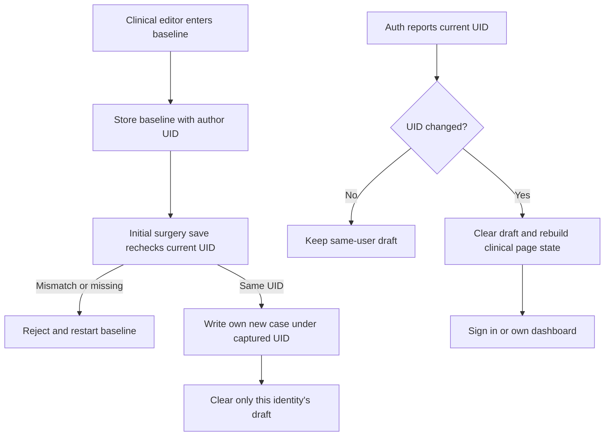

# Security review and release gate

24 October 2026. Local work only; no production data/rules/claims, Git push or Vercel deployment changed.

## Evidence and completed fix

Codex Security Standard scan 33ec3468-3e22-4229-a4ba-b1f84eeaf0e6 inspected the pre-fix current working tree, with an independent baseline and architecture review.59 distinct non-generated text files reviewed; dependencies/generated assets/state/private credential contents excluded. This was static source review, not a live penetration test or compliance certification.

One low-severity source finding concerned a baseline draft retained across logout in the same loaded browser. Local correction binds drafts to their creator UID, clears on all Auth UID changes and menu logout, rechecks ownership immediately before save, and prevents late responses from clearing another identity's draft. The root layout remounts clinical page state on UID change and reacts to external logout. No database migration or extra runtime library.

Check0/0, build and whitespace checks passed. Local regression tests cover draft isolation, legitimate same-user retention, direct identity switches and late cleanup, plus the existing authorization/numbering/outcome controls. Browser tests verify old draft disabled after logout+Back, external-tab logout removes loaded clinical pages, and a legitimate own-case save remains possible. One synthetic test case and two accounts removed; original8 literature cases/children unchanged by full snapshot hash. The sealed scan remains a historical pre-fix report; separate fix evidence documents the later change. Additional independent fix reviewer unavailable due usage limit; parent completed separate boundary/bypass passes.

## Historical blockers as of 24 October (superseded below)

- Existing production rules differ from the tested candidate. Verify and publish only with explicit user approval; source controls do not establish deployed parity.
- npm audit (read-only, no updates) reports28 affected package entries:4critical,12high,10moderate,2low. Determine applicable runtime/build/admin paths and perform controlled updates; do not equate entries with proven attacks or use blind forced upgrades.
- Remote Vercel previews currently select production Firebase outside loopback/dev. Separate staging configuration and test data, fail closed on missing configuration, and verify preview audience before publishing a preview.
- Confirm actual provider project, region, IAM/admin MFA, revocation/recovery, admission, headers, backups/restore and monitoring. These were not validated from provider dashboards.
- Agree controller, legal basis, minimisation/retention, processor/transfer documentation, DPIA assessment and study governance with the institution. Treat patient dates/free text as sensitive pseudonymised data. No assertion of complete GDPR/CRA/NIS2/MDR conformity. Firebase documents US processing for Auth; Firestore location is a separate setting and remains unverified.

## Identity-scoped patient draft

Code: src/lib/stores/caseStore.ts, src/lib/firebase/firebase.ts, src/routes/+layout.svelte and patients/new pages.

## 27 October update

Ownership/profile/admin-write corrections and permanent team approval are now published in Firestore; byte-for-byte readback confirms the tested source. Normal users require a separate administrator-controlled membership, including existing accounts; no patient migration or automatic approval. The local suite additionally verifies anonymous access, foreign writes/deletes, profile approval spoofing, membership schema/admin attribution, pending-account denial, legitimate approval and revocation.

Known-package audit now has zero critical/high/moderate entries and two low entries. SvelteKit2 low advisories concern enhanced server-form redirects and attacker-controlled prerender cache-control; neither enhanced/server actions nor prerendered routes are used here. Package overrides and exact versions are in package-lock.json; this is not a guarantee against unknown vulnerabilities. Preview deployment builds fail closed; production browser headers are configured in vercel.json and require hosted readback.

Firestore region and index confirmed; database deletion protection/PITR disabled. Provider IAM/admin MFA, complete backup/restore, rate/quota monitoring, incident response and institutional privacy/study approval remain open. See release-readiness.md for the current release boundary.

### Shared-browser memory cache follow-up

Auth UID changes do not clear a Firestore instance’s remote-document memory cache. A local SDK regression reproduces cached A data after switching that same client to B. Application Auth changes now replace the full document; restored browser-history pages reload too. A recreated client has no A cache and B’s server read remains denied. This closes the application’s ordinary shared-browser session boundary; it cannot retract data already copied or protect an unlocked operating-system session from its operator.
