# MediTrack: Codeabläufe verstehen

Stand: 24.10.2026 · lokale Arbeitsversion, nicht veröffentlicht. Frühere Änderungsabschnitte bleiben datiert; aktueller Sicherheitsstand siehe security-review.md.

Diese Diagramme beschreiben den gelesenen Code, keine geplante Zielarchitektur. Sie sind eine technische Arbeitsdokumentation und Grundlage für spätere Abbildungen der Dissertation. Bei Änderungen am Datenfluss diese Datei aktualisieren. Sie enthalten keine Patientendaten oder Zugangsdaten. Für eine wissenschaftliche Veröffentlichung müssen Abbildungen einem konkreten Versionsstand zugeordnet werden.

## Die Bausteine

- **Svelte-Seite:** zeigt Felder an und reagiert auf Eingaben.
- **Speicherfunktion:** sammelt Feldwerte und ruft Firebase auf.
- **Store:** vorübergehender Speicher im Arbeitsspeicher des Browsers.
- **Firebase Auth:** verwaltet Anmeldung und Benutzerkennung (UID).
- **Firestore:** speichert Dokumente dauerhaft. Security Rules entscheiden über erlaubte Zugriffe; das Ausblenden eines Buttons ersetzt diese Regeln nicht.

## 1. Anmeldung und Patientenübersicht

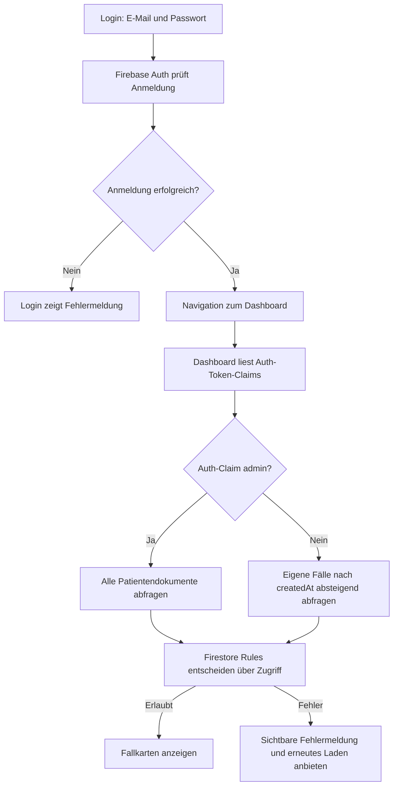

Code: `src/routes/login/+page.svelte` → `src/routes/dashboard/+page.svelte` → `src/lib/components/PatientList.svelte`. Das Root-Layout (`src/routes/+layout.ts`) liest zusätzlich Auth-Zustand und Claims für die gemeinsame Navigation; Profiltexte werden separat geladen.

**Aktuell:** Die Oberfläche und der Regelkandidat verwenden Auth-Claims, nicht das Profil-Rollenfeld. Lokale Zugriffstests bestanden; produktive Regelabweichungen sind dokumentiert und noch nicht veröffentlicht korrigiert. Die Admin-Abfrage hat weiterhin keine explizite Sortierung.

## 2. Patient mit Initialoperation anlegen

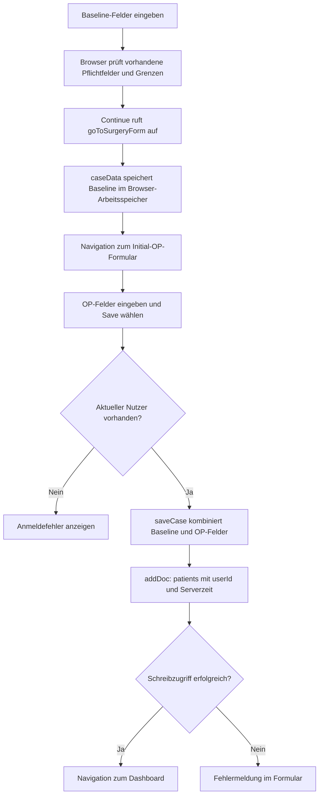

Code: `src/routes/patients/new/+page.svelte` → `src/lib/stores/caseStore.ts` → `src/routes/patients/new/surgery/+page.svelte`.

**Wichtig:** Initial-OP und Baseline liegen gemeinsam im Patientendokument. Weitere OPs liegen in einer Unterkollektion. Der Store ist noch kein gespeicherter Datenbankentwurf.

**Stand 24.10.2026:** Neuladen verliert den Entwurf; die initiale OP kann ohne Baseline nicht gespeichert werden. Ein vollständiger Seitenaufruf führt zur Baseline zurück. Nach erfolgreichem Speichern wird der Store geleert. Neue Fälle bewahren Baseline-Bemerkungen als `baselineComments` und OP-Bemerkungen als `comments`. Keine Migration alter Fälle. Fachliche Vollständigkeit und Plausibilität werden noch nicht verlässlich geprüft.

## 3. Weitere Dokumentation speichern

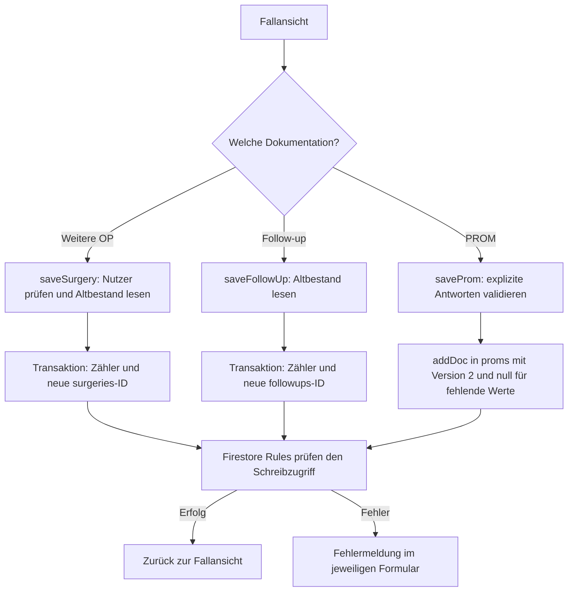

Code: die drei Seiten unter `src/routes/patients/[id]/{surgery,followup,proms}/+page.svelte`. Alle Unterkollektionen gehören zu `patients/{patientId}`. Die gemeinsame Transaktionsfunktion erzeugt zufällige IDs für weitere OPs und Follow-ups. PROMs nutzen addDoc.

**Stand 24.10.2026:** Neue Follow-ups und weitere OPs verwenden zufällige Dokument-IDs und einen atomaren Patientenzähler (siehe Abschnitt unten). Weitere-OP-Nummern zählen zusätzliche OPs ohne Initial-OP. Die manuelle Follow-up-Nummer entfällt. Neue PROMs starten leer und tragen Version 2; Altwerte bleiben unklar. Neue Follow-ups und PROMs benötigen Operations-ID und Erhebungsdatum; historische Dokumente bleiben unverändert.

## 4. Einen Fall anzeigen

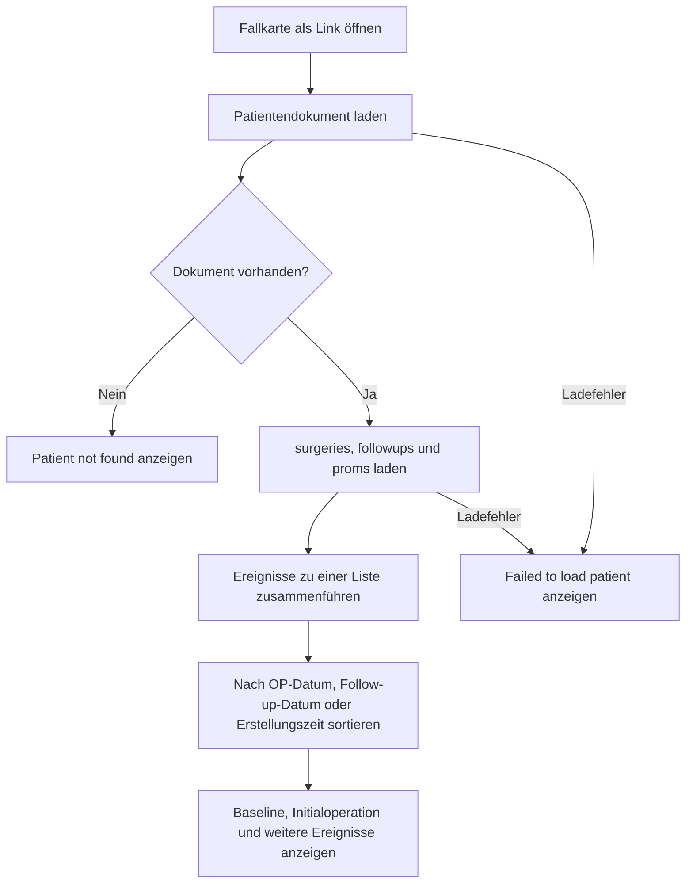

Code: `src/lib/components/PatientList.svelte` verlinkt auf `src/routes/patients/[id]/+page.svelte`. Nach erfolgreichem Speichern navigieren die Formulare wieder hierher; die Ansicht lädt die Dokumentation erneut.

**Anzeige aktualisiert (21.10.2026):** Baseline und Initialoperation werden getrennt dargestellt; Zahlen und boolesche Werte bleiben sichtbar. Die Komponente `RecordFields.svelte` übersetzt Feldbezeichnungen für die Anzeige, ohne Daten zu verändern. **Offen:** Die Initialoperation liegt weiterhin im Hauptdokument und wird separat vor den weiteren Ereignissen angezeigt. Die Sortierung ist keine verlässliche OP-Zuordnung und keine wissenschaftliche Verlaufsanalyse.

## 5. Registrierung

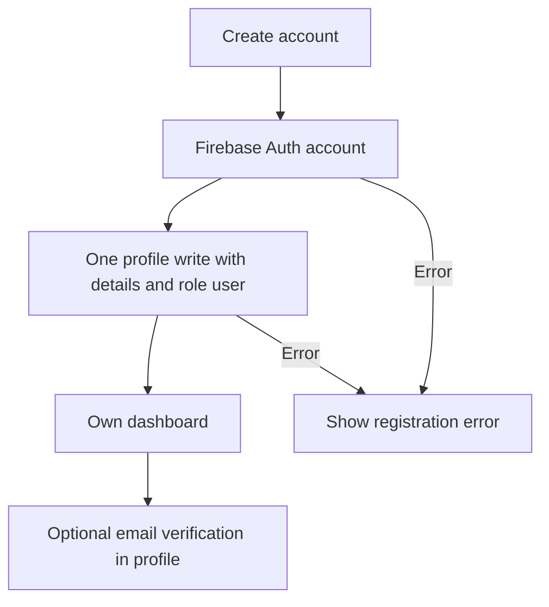

Auth-Konto und Profil sind nicht atomar; bei einem Profilfehler kann das Konto schon existieren. Die E-Mail-Verifizierung ist keine Prüfung ärztlicher Qualifikation.

## Änderung am 21.10.2026: 77 Warnungen behoben

| Bisher | Jetzt | Zweck |
|---|---|---|
| 69 Beschriftungen ohne technische Feldzuordnung | `label for` verweist auf die jeweilige Feld-`id` | Beschriftung anklickbar und für Hilfstechnologien zugeordnet |
| Fallkarten als anklickbare div-Elemente (4 Warnungen) | echte Links mit sichtbarem Tastaturfokus | Navigation per Maus und Tastatur |
| Avatarbilder anklickbar; Gruppenlabel unverbunden (3 Warnungen) | beschriftete Buttons mit Auswahlzustand, fieldset und legend | Tastaturbedienung und verständliche Gruppierung |
| selbstschließendes div (1 Warnung) | regulär geschlossenes div | eindeutiges HTML |

Keine neuen App-Abhängigkeiten, keine Unterdrückung von Warnungen, keine Änderungen am Speichermodell. Neue Datei im Projekt: nur diese Dokumentation. Codeprüfung: **0 Fehler, 0 Warnungen**. Build: erfolgreich; adapter-auto erkennt bei lokalem Build keine Hostingplattform. Keine Schreibtests in Firebase und kein manueller vollständiger UI-Test durchgeführt. Die hier beschriebenen offenen Funktionsfehler werden durch die warnungsfreie Prüfung nicht behoben.

## Ergänzung: UI-Gesamtdurchgang vom 21.10.2026

Alle klinischen Eingaben nutzen jetzt native Formulare. Ihre bestehenden Speicherfunktionen und Datenpfade sind unverändert; vorhandene HTML-Validierung greift vor dem Submit. Login und Registrierung haben einen sichtbaren Pending-Zustand. Die Patientenliste zeigt je Seite maximal 25 bereits geladene Fälle; dies ändert die Datenbankabfrage nicht. Der alte `/case`-Prototyp leitet auf die reguläre Anlage um und schreibt keine Beispieldaten mehr. Die lokale Testansicht `/dev/ui` verwendet ausschließlich synthetische Daten ohne Speicheraktion und ist im Produktionsbuild gesperrt. Prüfgrenzen und bekannte offene fachliche Fehler siehe `ui-review.md`.

## Local test isolation (2026-10-23)

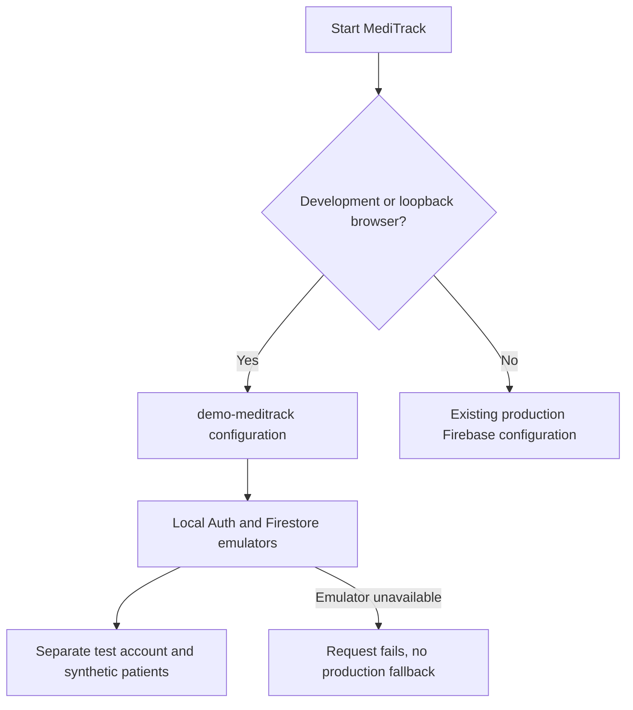

Reload existing tabs after changing the connection. Local emulator rules are a proposed test policy; production rule parity is not established.

## Published individual-case extraction (2026-10-23)

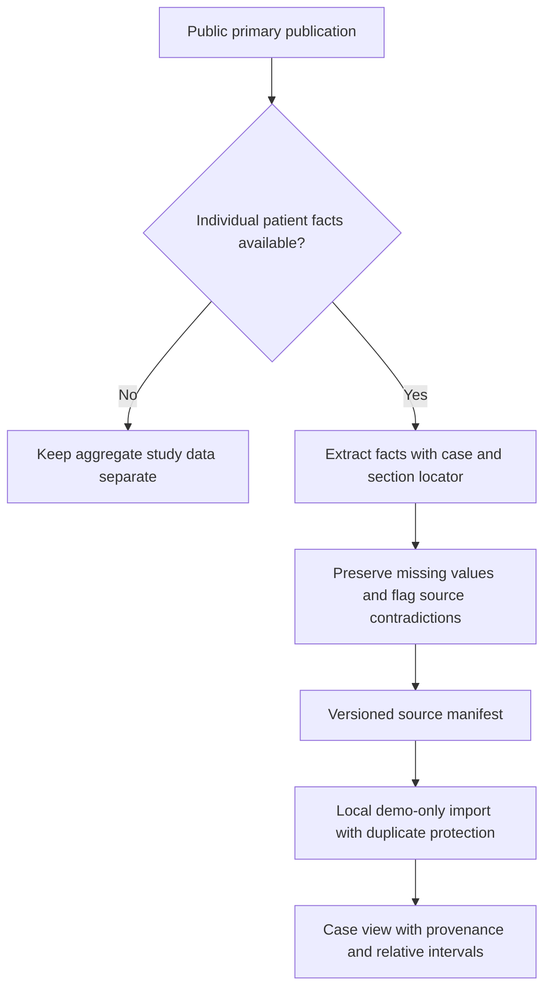

Literature extracts are selected publication cases, not newly recruited patients or a representative cohort.

## Atomare Nummerierung und deskriptive Analyse (24.10.2026)

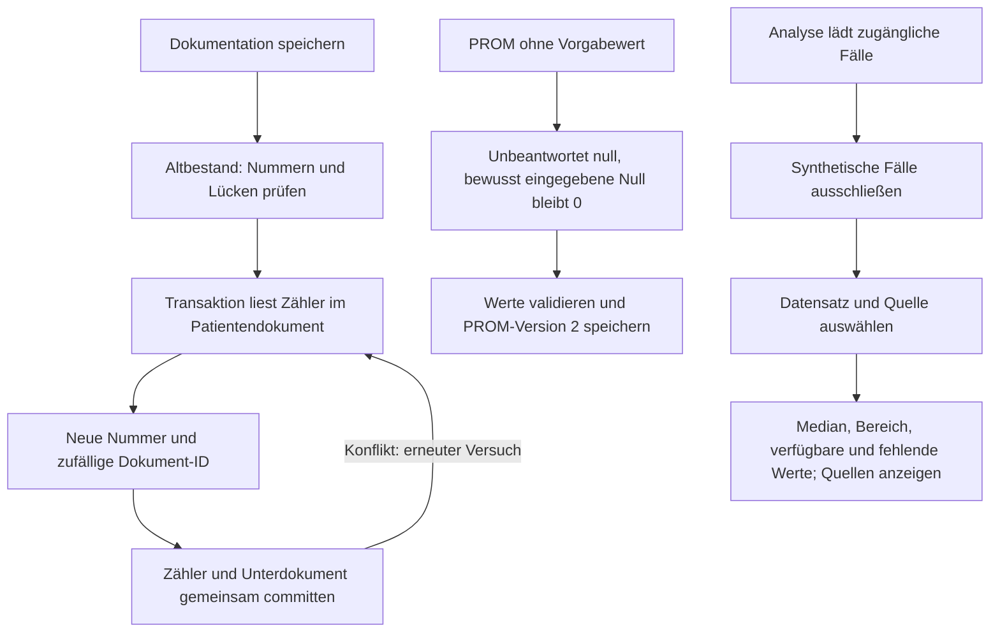

Code: src/lib/firebase/documentation.ts, src/lib/prom.ts, src/lib/analysis/summary.ts und src/routes/analysis/+page.svelte. Produktive Regelprüfung steht aus. Die gefüllte Analyse wurde nach ausdrücklicher lokaler Lesefreigabe auf Desktop und bei320px geprüft; temporäres Konto und Rechte anschließend entfernt.

## Claim-based access and linked assessments — 24 October 2026

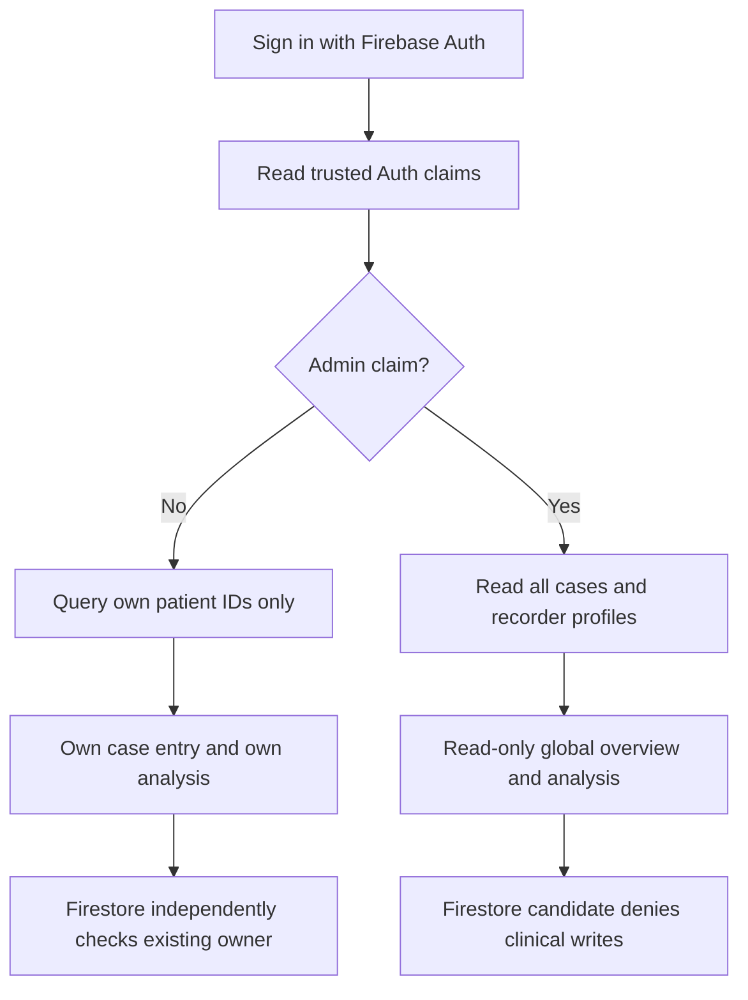

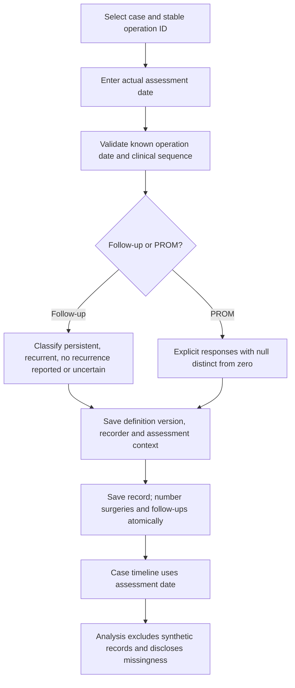

Registration: create Auth account, then one default-user profile write. These two services are not atomic; a profile failure can leave a sign-in-capable account requiring recovery. Actual deployed rule differences are documented in release-readiness.md; the above write boundary describes the tested candidate, not current production.

## Kontowechsel und Patientenentwürfe — 24.10.2026

Entwürfe gehören zu einer Auth-UID. Logout und direkte UID-Wechsel löschen sie; vor dem Speichern wird die UID erneut geprüft. Die gesamte klinische Seiteninstanz wird bei Kontoänderung neu aufgebaut. Abmelden in einem zweiten Tab führt ebenfalls zurück zur Anmeldung. Verspätete Speicherantworten von A löschen keinen Entwurf von B. Siehe Diagramm und Nachweise in security-review.md.

## Dauerhafte Team-Freischaltung — 27.10.2026

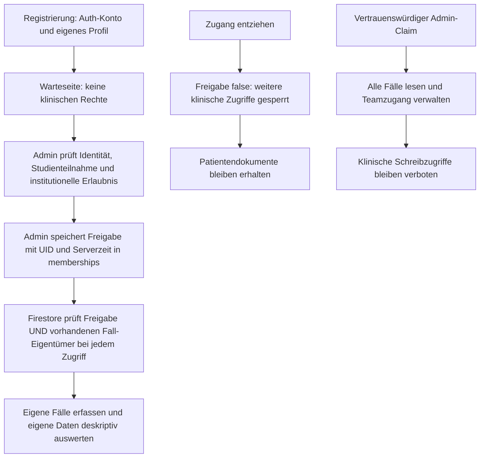

Code: src/lib/access.ts, src/routes/+layout.ts, src/routes/pending, src/routes/admin/users und security/firestore.rules. Profilfelder können keine Freigabe oder Adminrolle erteilen. Bereits gelesene Daten lassen sich durch einen Rechteentzug nicht aus externen Kopien zurückholen.

## Paketwartung und Datensicherung — 27.10.2026

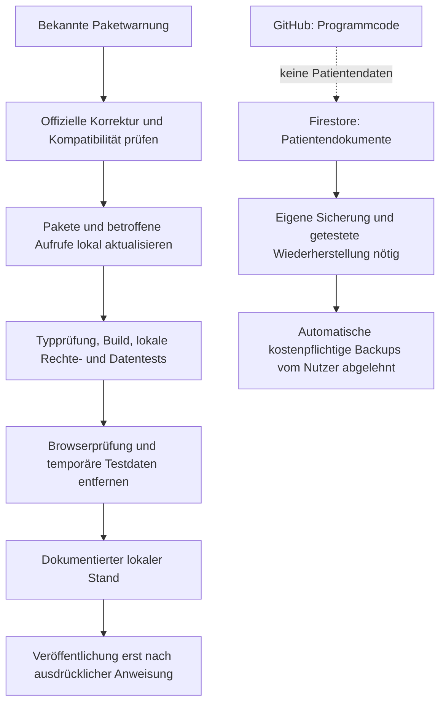

Der Paketstand wurde zunächst lokal aktualisiert und geprüft; die anschließende Veröffentlichung über GitHub/Vercel wurde am27.10. ausdrücklich beauftragt. Der Bereitstellungsnachweis liegt im Arbeitsbereich. Die Backup-Lücke bleibt offen. Es wurde weder eine automatische Sicherung aktiviert noch eine lokale Kopie echter Patientendaten angelegt.
